# Toán 1
### 1. Các số đến 10. Hình vuông, hình tròn, hình tam giác
### Nhiều hơn, ít hơn
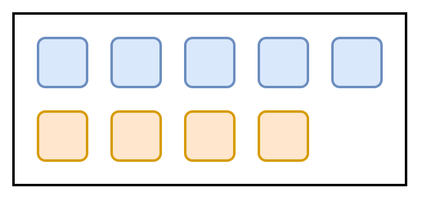 &emsp; 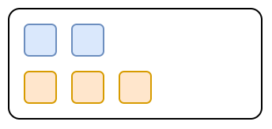

### Hình vuông, hình tròn
 &emsp; 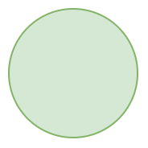

### Hình tam giác
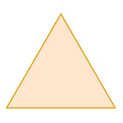

### Các số 1, 2, 3
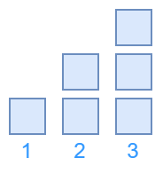

### Các số 1, 2, 3, 4, 5
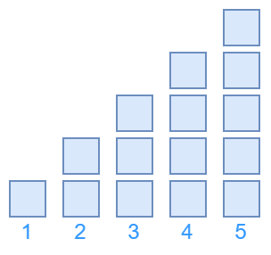

### Bé hơn. Dấu <
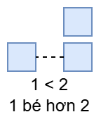 &emsp; 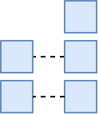

### Lớn hơn. Dấu >
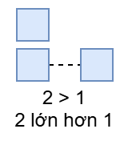 &emsp; 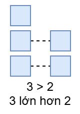

### Bằng nhau. Dấu =
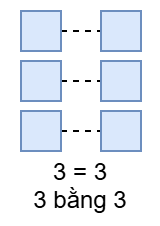 &emsp; 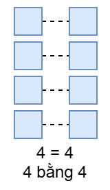

### Số 6

### Số 7
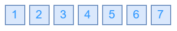

### Số 8

### Số 9
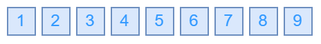

### Số 0
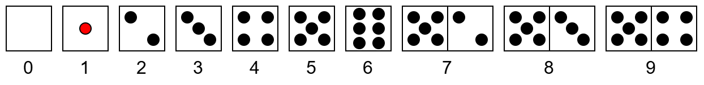

### Số 10
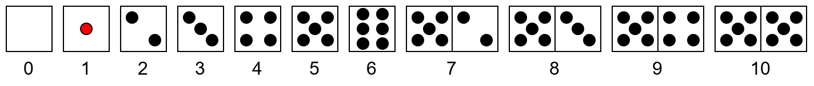

### 2. Phép cộng, phép trừ trong phạm vi 10
### Phép cộng trong phạm vi 3
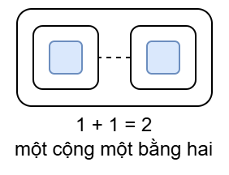 &emsp; 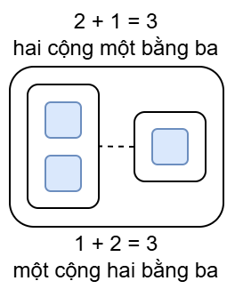 &emsp; 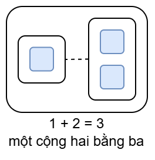

### Phép cộng trong phạm vi 4
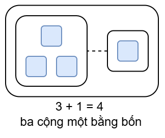 &emsp; 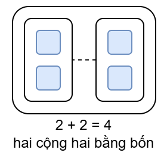 &emsp; 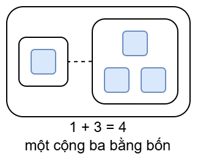

### Phép cộng trong phạm vi 5
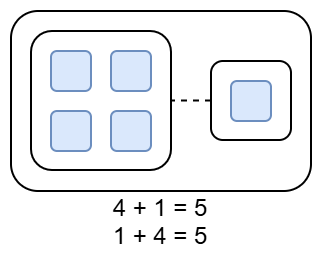 &emsp; 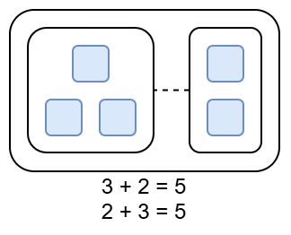

### Số 0 trong phép cộng
### Phép trừ trong phạm vi 3
### Phép trừ trong phạm vi 4
### Phép trừ trong phạm vi 5
### Số 0 trong phép trừ
### Phép cộng trong phạm vi 6
### Phép trừ trong phạm vi 6
### Phép cộng trong phạm vi 7
### Phép trừ trong phạm vi 7
### Phép cộng trong phạm vi 8
### Phép trừ trong phạm vi 8
### Phép cộng trong phạm vi 9
### Phép trừ trong phạm vi 9
### Phép cộng trong phạm vi 10
### Phép trừ trong phạm vi 10
### Bảng cộng và bằng trừ trong phạm vi 10

### 3. Các số trong phạm vi 100, đo độ dài. Giải bài toán
### Điểm. Đoạn thẳng
### Độ dài đoạn thẳng
### Thực hành đo độ dài
### Một chục. Tia số
### Mười một, mười hai
### Mười ba, mười bốn, muời lăm
### Mười sáu, muời bảy, muời tám, mười chín
### Hai muơi. Hai chục
### Phép cộng dạng 14 + 3
### Phép trù dạng 17 - 3
### Phép trù dạng 17 - 7
### Bài toán có lời văn
### Giải toán có lời văn
### Xăng-ti-mét. Đo độ dài
### Vẽ đoạn thẳng có độ dài cho trước
### Các số tròn chục
### Cộng các số tròn chục
### Trù các số tròn chục
### Điểm ở trong, điểm ở ngoài một hình
### Các số có hai chữ số
### Các số có hai chữ số (tiếp theo)
### Các số có hai chữ số (tiếp theo)
### So sánh các số có hai chữ số
### Bảng các số từ 1 đến 100
### Giải toán có lời văn (tiếp theo)

### 4. Phép cộng, phép trừ trong phạm vi 100. Đo thời gian
### Phép cộng trong phạm vi 100 (cộng không nhớ)
### Phép trừ trong phạm vi 100 (trừ không nhớ)
### Phép trừ trong phạm vi 100 (trừ không nhớ)
### Các ngày trong tuần lễ
### Cộng, trừ (không nhớ) trong phạm vi 100
### Đồng hồ. Thời gian
